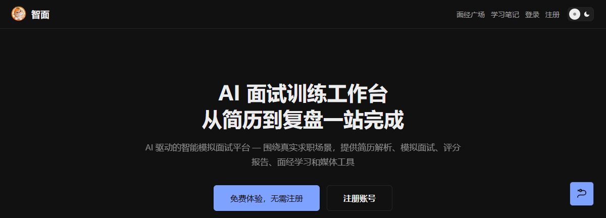
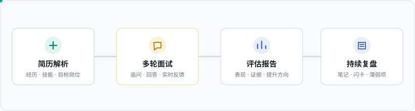
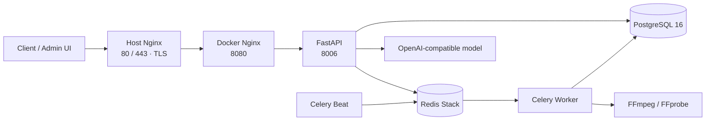

<p align="center">
  
</p>

<h1 align="center">AI-Interview · 智面</h1>

<p align="center">English · <a href="README.md">中文</a></p>

<p align="center">A connected workflow for resume-aware interview practice, feedback, and review.</p>

<p align="center">
  <a href="https://github.com/LeonZhang778/ai-interview-shangxian/actions/workflows/main.yml"></a>
  <a href="https://github.com/LeonZhang778/ai-interview-shangxian/stargazers"></a>
  
  
  
</p>

<p align="center">
  
</p>

> Try the [live service](https://zhangzhengqiang.xyz). Guest access is currently enabled. This is a running service, not an isolated sandbox; do not upload real resumes or other sensitive personal information.

## Why AI-Interview

Interview preparation is often scattered across resume tools, question banks, chatbots, and note apps. A general-purpose chatbot can explain a topic, but it does not automatically keep the context of a specific resume, conduct a multi-turn interview for a target role, and turn performance into follow-up practice.

AI-Interview connects those steps: parse a resume, practice against a target role, receive streamed feedback, review a report, and continue with notes and weakness-focused exercises. It does not aim to replace general-purpose models; it puts model capabilities into a stateful workflow that can be reviewed and resumed.

## Product flow



| Before | During | After |
| --- | --- | --- |
| Parse PDF, DOCX, TXT, or Markdown resumes and set a target role | Multi-turn questions, follow-ups, and streamed feedback | Review reports and role gaps, save notes, and keep practicing |

Other modules include interview experience submissions and collections, flashcards, weak-area analysis, notifications, shared reports, and audio/video conversion, compression, trimming, merging, and redaction tools.

## Architecture



An interview request enters through the API with resume and role context. The service asks the model for questions, then streams answer feedback over SSE. Reports are stored in PostgreSQL; Redis backs LangGraph checkpoints and Celery messages. Workers process media tasks, while Celery Beat schedules periodic jobs.

The backend follows API → Service → Model layers. Client and Backoffice routes have separate authentication and share service-layer capabilities. API responses use `{code, message, data}`.

## Stack

| Layer | Technology |
| --- | --- |
| Client / admin | Vue 3, Vite, Pinia, Vue Router |
| API | Python 3.12, FastAPI, Pydantic |
| Data / migrations | SQLAlchemy 2, asyncpg, Alembic |
| Storage / queue | PostgreSQL 16, Redis Stack, Celery |
| AI workflow | OpenAI-compatible model APIs, LangGraph |
| Media | FFmpeg / FFprobe |
| Deployment | Docker Compose, Nginx, GitHub Actions |

## Quick start

### Requirements

- Docker Engine and Docker Compose V2
- Node.js 18+ and npm
- An OpenAI-compatible API key for AI features; `.env.example` currently uses DeepSeek
- Basic experience with Docker Compose, environment variables, and npm

There is no local mock mode, bundled demo account, or seeded demo dataset. Use the live service to explore the product without local setup. Running AI features locally requires your own model API key. The backend image includes FFmpeg / FFprobe for media processing.

### Configure and start the backend

```bash
cd ai-interview-backend
cp .env.example .env
```

On Windows PowerShell, use `Copy-Item .env.example .env`. Set database, Redis, JWT, and model settings in `.env`. Never commit `.env`, credentials, API keys, or server access details.

| Variable | Purpose | Required | Development default / example |
| --- | --- | --- | --- |
| `ENV` | Runtime environment | No | `development` |
| `API_PORT` | FastAPI port | No | `8006` |
| `POSTGRES_USER` | PostgreSQL user | Yes | `demo` |
| `POSTGRES_PASSWORD` | PostgreSQL password | Yes | Set locally |
| `POSTGRES_HOST` | Database host in dev Compose | Yes | `localhost` |
| `POSTGRES_PORT` | Dev Compose database port | Yes | `5434` |
| `POSTGRES_DB` | Database name | Yes | `ai_interview` |
| `REDIS_HOST` / `REDIS_PORT` | Redis connection | Yes | `localhost` / `6379` |
| `REDIS_PASSWORD` | Redis password | Yes | Set locally; do not leave blank |
| `SECRET_KEY` | JWT signing key | Yes | Random local value; strong random value in production |
| `AI_API_KEY` | Default model API key | For AI features | Your provider API key |
| `AI_BASE_URL` | OpenAI-compatible endpoint | For AI features | `https://api.deepseek.com/v1` |
| `AI_MODEL` | Default model name | For AI features | `deepseek-flash` |
| `AI_MODEL_FALLBACK` | Fallback model | No | Empty |

From `ai-interview-backend`, start services and initialize the database:

```bash
docker compose -f docker-compose.yml -f docker-compose.dev.yml up -d --build
docker compose -f docker-compose.yml -f docker-compose.dev.yml exec app alembic upgrade head
docker compose -f docker-compose.yml -f docker-compose.dev.yml exec app python scripts/seed_settings.py
```

Do not skip `seed_settings.py` on a fresh database. Health check: `http://localhost:8006/api/v1/config/health`.

### Start the frontends

In separate terminals from the repository root:

```bash
cd ai-interview-frontend
npm ci
npm run dev
```

```bash
cd ai-interview-admin
npm ci
npm run dev
```

Client: `http://localhost:3000`. Admin: `http://localhost:3001`. Vite proxies API requests to `http://127.0.0.1:8006` by default.

## Verification

Activate the backend virtual environment, then run the same test command on Linux, macOS, and Windows:

```bash
cd ai-interview-backend
source .venv/bin/activate
python -m pytest tests -q
```

On Windows PowerShell, activate with `.\.venv\Scripts\Activate.ps1`, then run `python -m pytest tests -q`. For the client, run `npm run build` and `npm test` from `ai-interview-frontend`; for the admin app, run `npm run build` from `ai-interview-admin`. Playwright E2E tests require a reachable app and browser; set `PLAYWRIGHT_CHROME_PATH` to configure Chrome.

### Default ports

| Service | Port | Notes |
| --- | ---: | --- |
| Client Vite | `3000` | User interface |
| Admin Vite | `3001` | Admin interface |
| FastAPI | `8006` | API and health check |
| PostgreSQL | `5434` | Maps to container port `5432` |
| Redis | `6379` | Dev mapping |
| Docker Nginx | `8080` | Production container entry, host loopback only |
| Host Nginx | `80` / `443` | Production HTTP / HTTPS entry |

## API quick look

Local API base URL: `http://localhost:8006`. Development Swagger UI is available at `/client/docs` and `/backoffice/docs`. The root `/docs` route is disabled.

```bash
curl http://localhost:8006/api/v1/config/health
curl http://localhost:8006/api/v1/config/release
```

Guest login creates a guest account and returns a token. Run only against a local development instance:

```bash
curl -X POST http://localhost:8006/api/v1/auth/guest
```

Authenticated resume upload and interview start:

```bash
export API=http://localhost:8006
export TOKEN='<access_token>'

curl -X POST "$API/api/v1/resumes/upload" \
  -H "Authorization: Bearer $TOKEN" \
  -F "file=@./resume.pdf" \
  -F "target_position=Python backend engineer"

curl -X POST "$API/api/v1/interviews/start" \
  -H "Authorization: Bearer $TOKEN" \
  -H "Content-Type: application/json" \
  -d '{"resume_id":1,"target_position":"Python backend engineer","difficulty":"medium","total_questions":5}'
```

Resume upload accepts PDF, DOCX, TXT, and Markdown files up to 30 MB. Authenticated endpoints require a user token. Responses use `{code, message, data}`.

## Production deployment

Traffic follows **80/443 → host Nginx (TLS) → Docker Nginx `8080` → FastAPI `8006`**. PostgreSQL and Redis stay on the Docker network. Celery workers process queued jobs; Celery Beat schedules recurring tasks. Nginx disables buffering for interview SSE and applies the media upload limit.

Production deployments are triggered by pushes to `main` through [GitHub Actions](.github/workflows/main.yml). See [Docker Compose](ai-interview-backend/docker-compose.yml) and the [host Nginx config](deploy/host-nginx/ai-interview.conf). Keep server addresses, passwords, private keys, and `.env` values out of source control and public issues.

## Troubleshooting

<details>
<summary>PostgreSQL or Redis connection refused</summary>

Run `docker compose ps`, wait for `postgres` and `redis` health checks, and verify `.env`. In dev Compose, PostgreSQL maps to `5434` and Redis to `6379`.

</details>

<details>
<summary>Guest login or settings fail on a new database</summary>

Run both `alembic upgrade head` and `python scripts/seed_settings.py`.

</details>

<details>
<summary>Media tasks fail because FFmpeg is missing</summary>

Both the backend image and the worker need FFmpeg / FFprobe. Rebuild with the project Dockerfile and inspect worker logs.

</details>

<details>
<summary>Model requests fail</summary>

Check that `AI_API_KEY`, `AI_BASE_URL`, and `AI_MODEL` belong to the same provider and that the runtime can reach the endpoint.

</details>

## Contributing and project status

- **Contributing:** File reproducible bugs or proposals in [GitHub Issues](https://github.com/LeonZhang778/ai-interview-shangxian/issues). Pull Requests should include relevant test results.
- **Roadmap:** Follow planned work in [GitHub Issues](https://github.com/LeonZhang778/ai-interview-shangxian/issues); no standalone roadmap is published yet.
- **Releases:** Follow [GitHub Releases](https://github.com/LeonZhang778/ai-interview-shangxian/releases). No formal version tags or coverage data are published yet.
- **Conduct:** Keep discussions respectful; do not post personal information or production credentials.
- **Security:** Do not post exploit details or secrets publicly. Use [private vulnerability reporting](https://github.com/LeonZhang778/ai-interview-shangxian/security/advisories/new) if enabled; otherwise contact the maintainer privately.

## License

This project is licensed under the [MIT License](LICENSE).
