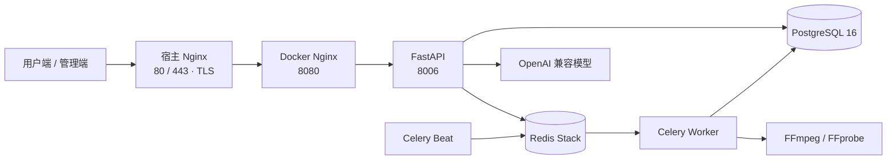

<p align="center">
  
</p>

<h1 align="center">AI-Interview · 智面</h1>

<p align="center">
  <a href="README-en.md">English</a> · 中文
</p>

<p align="center">
  把简历、模拟面试、评估反馈和复盘练习放进同一条求职准备流程。
</p>

<p align="center">
  <a href="https://github.com/LeonZhang778/ai-interview-shangxian/actions/workflows/main.yml"></a>
  <a href="https://github.com/LeonZhang778/ai-interview-shangxian/stargazers"></a>
  <a href="LICENSE"></a>
  
  
  
</p>

<p align="center">
  <a href="#为什么做智面">为什么做</a> ·
  <a href="#产品预览">产品预览</a> ·
  <a href="#快速开始">快速开始</a> ·
  <a href="#API-速览">API</a> ·
  <a href="#生产部署">生产部署</a>
</p>

<p align="center">
  
</p>

> [!TIP]
> 在线体验：[智面 AI](https://zhangzhengqiang.xyz)。线上当前开放游客模式；这是正在运行的服务，不是隔离的演示环境，请勿上传真实简历或其他敏感个人信息。

## 为什么做智面

面试准备常被拆散在简历工具、题库、聊天机器人和笔记应用里。通用问答可以解释知识点，却很难持续记住某一份简历、围绕目标岗位追问，再把回答表现转成下一轮可执行的练习。

智面围绕这段连续过程组织产品：先解析简历和岗位目标，再进行多轮模拟面试与流式反馈，最后用报告、面经、学习笔记和薄弱项复盘。它的定位不是替代通用模型，而是把模型能力嵌入一个有上下文、有会话状态、能回看和继续练习的产品流程。

## 产品预览


| 面试前 | 面试中 | 面试后 |
| --- | --- | --- |
| 解析 PDF、DOCX、TXT、Markdown 简历，结合目标岗位准备问题 | 多轮问答、追问与流式反馈；会话可恢复 | 查看评估报告、岗位差距，整理面经与笔记并持续复习 |

其他模块包括面经投稿与收藏、闪卡、错题与薄弱项分析、公告通知、面试报告分享，以及音视频转换、压缩、裁剪、合并和遮挡工具。

## 架构



一次面试从用户端携带简历与岗位信息进入 API；服务读取用户数据并调用模型生成问题，答案通过 SSE 流式返回评估。报告保存到 PostgreSQL，LangGraph 检查点和 Celery 消息由 Redis 支撑；Worker 执行媒体任务，Beat 负责周期性任务调度。

后端遵守 API → Service → Model 分层。用户端与 Backoffice 使用各自的认证和路由，共用服务层。API 使用统一响应结构 `{code, message, data}`。

## 技术栈

| 层 | 技术 |
| --- | --- |
| 用户端 / 管理端 | Vue 3、Vite、Pinia、Vue Router |
| API 服务 | Python 3.12、FastAPI、Pydantic |
| 数据访问 / 迁移 | SQLAlchemy 2、asyncpg、Alembic |
| 数据与队列 | PostgreSQL 16、Redis Stack、Celery |
| AI 工作流 | OpenAI 兼容模型接口、LangGraph |
| 媒体任务 | FFmpeg / FFprobe |
| 部署 | Docker Compose、Nginx、GitHub Actions |

## 快速开始

### 前置条件

- Docker Engine 与 Docker Compose V2
- Node.js 18+ 和 npm
- AI 面试、简历解析等模型功能需要可用的 OpenAI 兼容 API Key；当前 `.env.example` 使用 DeepSeek 配置
- 使用媒体处理功能时需要 FFmpeg；后端 Docker 镜像已安装 FFmpeg / FFprobe
- 需要能运行 Docker Compose、编辑环境变量和使用 npm 的基础经验

本地没有随仓库提供的 mock 模式、预置账号或演示数据。只想先看产品时，可直接使用上方线上体验；本地完整运行模型功能需要自行配置 API Key。

### 1. 配置后端

```bash
cd ai-interview-backend
cp .env.example .env
```

Windows PowerShell 对应命令：

```powershell
Set-Location ai-interview-backend
Copy-Item .env.example .env
```

编辑 `.env` 中的数据库、Redis、JWT 和模型配置。以下为本地 Compose 开发所需的主要变量；示例值来自 `.env.example`，尖括号表示需要自行填写的本地值。

| 变量 | 用途 | 必填 | 开发默认 / 示例 |
| --- | --- | --- | --- |
| `ENV` | 运行环境 | 否 | `development` |
| `API_PORT` | FastAPI 监听端口 | 否 | `8006` |
| `POSTGRES_USER` | PostgreSQL 用户 | 是 | `demo` |
| `POSTGRES_PASSWORD` | PostgreSQL 密码 | 是 | 自行设置，不要使用生产密码 |
| `POSTGRES_HOST` | 开发 Compose 下的数据库主机 | 是 | `localhost` |
| `POSTGRES_PORT` | 开发 Compose 映射端口 | 是 | `5434` |
| `POSTGRES_DB` | 数据库名 | 是 | `ai_interview` |
| `REDIS_HOST` | Redis 主机 | 是 | `localhost` |
| `REDIS_PORT` | Redis 端口 | 是 | `6379` |
| `REDIS_PASSWORD` | Redis 密码 | 是 | 自行设置，不要留空 |
| `SECRET_KEY` | JWT 签名密钥 | 是 | 本地使用随机值；生产环境需使用强随机密钥 |
| `AI_API_KEY` | 默认模型通道密钥 | 使用 AI 功能时 | 自己的模型服务 API Key |
| `AI_BASE_URL` | OpenAI 兼容接口地址 | 使用 AI 功能时 | `https://api.deepseek.com/v1` |
| `AI_MODEL` | 默认模型名 | 使用 AI 功能时 | `deepseek-flash` |
| `AI_MODEL_FALLBACK` | 主模型失败时的备用模型 | 否 | 空 |

不要提交 `.env`、真实密码、API Key 或服务器凭据。生产环境必须设置独立的强 `SECRET_KEY` 与数据库/Redis 密码。

### 2. 启动后端依赖并初始化数据库

在 `ai-interview-backend` 目录运行：

```bash
docker compose -f docker-compose.yml -f docker-compose.dev.yml up -d --build
docker compose -f docker-compose.yml -f docker-compose.dev.yml exec app alembic upgrade head
docker compose -f docker-compose.yml -f docker-compose.dev.yml exec app python scripts/seed_settings.py
```

`seed_settings.py` 会初始化系统设置和功能开关；新环境不要跳过。健康检查地址为 `http://localhost:8006/api/v1/config/health`。

### 3. 启动前端

在仓库根目录分别打开终端：

```bash
cd ai-interview-frontend
npm ci
npm run dev
```

```bash
cd ai-interview-admin
npm ci
npm run dev
```

用户端默认地址为 `http://localhost:3000`，管理端为 `http://localhost:3001`。Vite 默认将 API 请求代理到 `http://127.0.0.1:8006`；后端不在本机时，修改对应的 `vite.config.js`。

### 默认端口

| 服务 | 本地开发端口 | 说明 |
| --- | ---: | --- |
| 用户端 Vite | `3000` | 用户界面 |
| 管理端 Vite | `3001` | 管理界面 |
| FastAPI | `8006` | API 与健康检查 |
| PostgreSQL | `5434` | Compose 映射到容器 `5432` |
| Redis | `6379` | 开发环境映射端口 |
| Docker Nginx | `8080` | 生产容器入口，仅绑定宿主机回环 |
| 宿主 Nginx | `80` / `443` | 生产 HTTP / HTTPS 入口 |

## 首次创建管理员

只在需要登录管理端时执行。Linux / macOS Bash：

```bash
read -r -p "Admin email: " INITIAL_ADMIN_EMAIL
read -r -s -p "Admin password: " INITIAL_ADMIN_PASSWORD
echo
docker compose exec -e INITIAL_ADMIN_EMAIL -e INITIAL_ADMIN_PASSWORD app python scripts/create_first_admin.py
unset INITIAL_ADMIN_EMAIL INITIAL_ADMIN_PASSWORD
```

Windows PowerShell：

```powershell
$env:INITIAL_ADMIN_EMAIL = Read-Host "Admin email"
$secure = Read-Host "Admin password" -AsSecureString
$ptr = [Runtime.InteropServices.Marshal]::SecureStringToBSTR($secure)
try {
  $env:INITIAL_ADMIN_PASSWORD = [Runtime.InteropServices.Marshal]::PtrToStringBSTR($ptr)
  docker compose exec -e INITIAL_ADMIN_EMAIL -e INITIAL_ADMIN_PASSWORD app python scripts/create_first_admin.py
} finally {
  [Runtime.InteropServices.Marshal]::ZeroFreeBSTR($ptr)
  Remove-Item Env:INITIAL_ADMIN_EMAIL, Env:INITIAL_ADMIN_PASSWORD -ErrorAction SilentlyContinue
}
```

以上命令需在 `ai-interview-backend` 目录执行。仓库不包含默认管理员账号或密码。

## 验证

后端在 Linux / macOS 激活虚拟环境：

```bash
cd ai-interview-backend
source .venv/bin/activate
python -m pytest tests -q
```

Windows PowerShell：

```powershell
Set-Location ai-interview-backend
.\.venv\Scripts\Activate.ps1
python -m pytest tests -q
```

用户端构建与 E2E 测试（在 `ai-interview-frontend` 目录运行）：`npm run build`、`npm test`。管理端构建（在 `ai-interview-admin` 目录运行）：`npm run build`。Playwright E2E 需要可访问的应用环境；可用 `PLAYWRIGHT_CHROME_PATH` 指定 Chrome 路径。

## API 速览

本地 API 基址为 `http://localhost:8006`。开发环境的 Swagger UI 为 `/client/docs` 和 `/backoffice/docs`；根路径 `/docs` 在应用中关闭。生产部署不公开默认 `/docs` 路径。

Windows PowerShell 可用 `Invoke-RestMethod http://localhost:8006/api/v1/config/health` 执行健康检查。

健康检查和版本信息不需要登录：

```bash
curl http://localhost:8006/api/v1/config/health
curl http://localhost:8006/api/v1/config/release
```

游客登录会创建一个游客账号并返回令牌，仅在本地开发环境运行此示例：

```bash
curl -X POST http://localhost:8006/api/v1/auth/guest
```

持令牌上传简历并开始面试：

```bash
export API=http://localhost:8006
export TOKEN='<access_token>'

curl -X POST "$API/api/v1/resumes/upload" \
  -H "Authorization: Bearer $TOKEN" \
  -F "file=@./resume.pdf" \
  -F "target_position=Python 后端工程师"

curl -X POST "$API/api/v1/interviews/start" \
  -H "Authorization: Bearer $TOKEN" \
  -H "Content-Type: application/json" \
  -d '{"resume_id":1,"target_position":"Python 后端工程师","difficulty":"medium","total_questions":5}'
```

简历接口支持 PDF、DOCX、TXT 和 Markdown，文件最大 30 MB。面试与简历接口需要用户令牌；接口返回遵循 `{code, message, data}`。生产环境的客户端和管理端 OpenAPI 文档分别挂载在 `/client/docs`、`/backoffice/docs`；是否对公网开放应由部署方按安全要求配置。

## 生产部署

生产拓扑为 **80/443 → 宿主 Nginx（TLS）→ Docker Nginx `8080` → FastAPI `8006`**。PostgreSQL 和 Redis 留在 Docker 网络内；Celery Worker 执行队列任务，Celery Beat 负责定时任务。Nginx 为面试 SSE 关闭缓冲，媒体上传上限与后端配置保持一致。

生产部署由 [GitHub Actions 工作流](.github/workflows/main.yml) 推送到 `main` 后触发，并使用仓库环境中的部署凭据。服务定义见 [Docker Compose](ai-interview-backend/docker-compose.yml)，宿主反向代理配置见 [Nginx 配置](deploy/host-nginx/ai-interview.conf)。不要把服务器 IP、密码、私钥或 `.env` 写入 README、提交记录或 issue。

## 常见问题

<details>
<summary>应用启动时 PostgreSQL 或 Redis 连接失败</summary>

先运行 `docker compose ps` 确认 `postgres`、`redis` 健康，再核对 `.env` 中的主机、端口、用户和密码。Compose 开发模式下 API 容器使用主机网络，数据库映射端口为 `5434`，Redis 为 `6379`。

</details>

<details>
<summary>游客登录或系统开关报错</summary>

确认已执行 `alembic upgrade head` 和 `python scripts/seed_settings.py`。新数据库缺少迁移字段或默认系统设置时，游客登录可能失败。

</details>

<details>
<summary>媒体任务失败或 FFmpeg 不存在</summary>

后端镜像和执行媒体任务的 Worker 都需要 FFmpeg / FFprobe。使用项目 Dockerfile 重建镜像，并检查 Worker 日志和任务状态。

</details>

<details>
<summary>模型请求失败</summary>

检查 `AI_API_KEY`、`AI_BASE_URL`、`AI_MODEL` 是否属于同一个兼容服务，并确认运行环境可访问该服务。密钥只放在本地 `.env` 或受限的部署 Secret 中。

</details>

## 参与贡献与项目状态

- **贡献**：欢迎通过 [Issues](https://github.com/LeonZhang778/ai-interview-shangxian/issues) 提交可复现的问题或改进建议；代码变更请附相关测试结果，并通过 Pull Request 讨论。
- **路线图**：当前能力以本 README 和代码为准；待办与讨论见 [GitHub Issues](https://github.com/LeonZhang778/ai-interview-shangxian/issues)。尚未发布独立 Roadmap 文件。
- **版本记录**：版本发布后会出现在 [GitHub Releases](https://github.com/LeonZhang778/ai-interview-shangxian/releases)。目前没有正式版本标签或覆盖率徽章数据，因此不展示 version / coverage 数值。
- **行为准则**：参与 issue、讨论和评审时保持尊重，不发布他人个人信息或生产凭据。
- **安全问题**：不要在公开 issue 中提交漏洞利用细节、用户数据或密钥；请使用 [GitHub 私有漏洞报告](https://github.com/LeonZhang778/ai-interview-shangxian/security/advisories/new)（若仓库未启用该功能，请联系仓库维护者）。

## 许可证

本项目基于 [MIT License](LICENSE) 发布。
