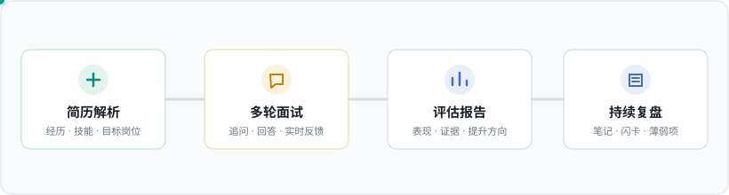
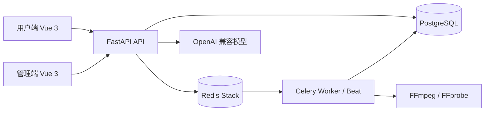

<p align="center">
  
</p>

<h1 align="center">AI-Interview · 智面</h1>

<p align="center">
  面向求职者的 AI 面试与成长平台：从简历解析、岗位面试，到反馈复盘与持续练习。
</p>

<p align="center">
  <a href="https://github.com/LeonZhang778/ai-interview-shangxian/actions/workflows/main.yml"></a>
  <a href="https://github.com/LeonZhang778/ai-interview-shangxian/stargazers"></a>
  
  
  
</p>

<p align="center">
  <a href="#能力范围">产品能力</a> ·
  <a href="#架构">架构</a> ·
  <a href="#本地开发">本地开发</a> ·
  <a href="#验证">验证</a> ·
  <a href="#配置与安全">配置与安全</a>
</p>

<p align="center">
  
</p>

AI-Interview（智面）把面试准备、模拟演练和复盘沉淀连接为一条完整流程。用户端与运营管理端由同一套 FastAPI 服务提供能力，面试会话、后台作业和媒体处理分别由 PostgreSQL、Redis 与 Celery 支撑。

## 能力范围

- **简历与面试**：上传并解析简历，基于目标岗位开展多轮模拟面试，流式接收提问与反馈，并查看面试评估报告。
- **复盘与学习**：整理面经和学习笔记，使用闪卡、错题与薄弱项分析持续复习。
- **求职协作**：支持面经浏览与投稿、收藏、通知、公告、反馈和报告分享等流程。
- **媒体工具**：提供音视频转换、压缩、裁剪、音轨提取、GIF、合并及遮挡类工具；耗时处理由后台任务执行。
- **运营管理**：管理用户、面试、面经、公告、反馈、系统设置和媒体任务，并查看统计及审计信息。

## 架构



后端按 API、Service、Model 分层。用户端和管理端拥有独立路由与认证入口，共用服务层能力。面试状态、媒体任务和异步作业分别由对应服务管理；配置通过环境变量注入。

## 技术栈

| 层 | 主要技术 |
| --- | --- |
| 用户端与管理端 | Vue 3、Vite、Pinia、Vue Router |
| API 服务 | Python 3.12、FastAPI、Pydantic |
| 数据访问 | SQLAlchemy 2、asyncpg、Alembic |
| 持久化与缓存 | PostgreSQL 16、Redis Stack |
| 异步任务 | Celery、Redis |
| AI 与流程 | OpenAI 兼容模型接口、LangGraph |
| 媒体处理 | FFmpeg / FFprobe |
| 部署 | Docker、Docker Compose、Nginx |

## 仓库结构

```text
ai-interview-backend/       FastAPI 服务、数据库迁移及后台任务
ai-interview-frontend/      用户端 Vue 应用
ai-interview-admin/         管理端 Vue 应用
deploy/                     宿主机 Nginx 配置
.github/workflows/          自动构建与部署流程
readme-assets/              README 流程图素材
```

## 本地开发

### 依赖

- Docker Engine 与 Docker Compose V2
- Node.js 18 或更高版本
- 可用的 OpenAI 兼容模型 API 凭据
- 媒体工具开发或运行需要 FFmpeg；后端镜像已安装 FFmpeg / FFprobe

### 启动后端及依赖

在后端目录准备本地配置：

```bash
cd ai-interview-backend
cp .env.example .env
```

编辑 `.env`，至少设置数据库与 Redis 凭据、`SECRET_KEY` 和 AI 模型 API 配置。不要将 `.env`、真实密钥或服务器凭据提交到仓库。

在 ai-interview-backend 目录中运行：

```bash
docker compose -f docker-compose.yml -f docker-compose.dev.yml up -d --build
```

服务就绪后执行数据库迁移：

```bash
docker compose -f docker-compose.yml -f docker-compose.dev.yml exec app alembic upgrade head
```

API 根路径为 `http://localhost:8006/api/v1`，健康检查为 `/config/health`，开发环境 API 文档为 `http://localhost:8006/docs`。

### 启动前端

分别在两个前端目录安装依赖并启动 Vite：

```bash
cd ai-interview-frontend
npm ci
npm run dev
```

```bash
cd ai-interview-admin
npm ci
npm run dev
```

用户端默认运行在 `http://localhost:3000`，管理端默认运行在 `http://localhost:3001`。两个 Vite 配置默认将 `/api`（用户端还包括 `/uploads`）代理到 `http://127.0.0.1:8006`；后端不在本机时，按开发环境修改各自的 `vite.config.js`。

<details>
<summary>初始化首个管理员</summary>

首次创建后台管理员时，在后端目录中通过当前终端的临时环境变量提供账号信息，再执行：

```bash
read -r -p "Admin email: " INITIAL_ADMIN_EMAIL
read -r -s -p "Admin password: " INITIAL_ADMIN_PASSWORD
echo
docker compose -f docker-compose.yml -f docker-compose.dev.yml exec \
  -e INITIAL_ADMIN_EMAIL="$INITIAL_ADMIN_EMAIL" \
  -e INITIAL_ADMIN_PASSWORD="$INITIAL_ADMIN_PASSWORD" \
  app python scripts/create_first_admin.py
unset INITIAL_ADMIN_EMAIL INITIAL_ADMIN_PASSWORD
```

仓库不提供默认管理员账号或密码。初始化成功后，请通过管理端登录页面登录。

</details>

### 停止服务

```bash
cd ai-interview-backend
docker compose -f docker-compose.yml -f docker-compose.dev.yml down
```

此命令保留 Compose 数据卷。删除数据卷会清除本地数据库和 Redis 持久化数据，操作前请确认数据可丢弃。

## 验证

在对应目录运行：

```bash
# 后端
.venv/Scripts/python.exe -m pytest tests -q

# 用户端构建与端到端测试
npm run build
npm test

# 管理端构建
npm run build
```

前端命令需分别在 `ai-interview-frontend` 和 `ai-interview-admin` 目录运行。Playwright 测试依赖可访问的应用环境；具体浏览器路径可通过 `PLAYWRIGHT_CHROME_PATH` 配置。

## 配置与安全

- 本地配置放在 `ai-interview-backend/.env`，示例模板为 `.env.example`。
- 生产环境必须使用独立的强随机 `SECRET_KEY`、数据库/Redis 凭据及模型 API 密钥；不要复用示例值或提交密钥。
- 生产部署由 `.github/workflows/main.yml` 和 Docker Compose 配置执行。部署凭据应保存在 CI Secret 或服务器的受限环境配置中。
- 面试简历和媒体文件可能包含个人信息。部署时应限制存储访问、下载权限、备份保留时间和日志内容。

## API

<details>
<summary>查看接口分区</summary>

接口按 `/api/v1` 组织。用户端主要覆盖认证、简历、面试、面经、学习笔记、通知、分享和媒体工具；管理端位于 `/api/v1/backoffice`，覆盖用户、面试、内容、设置、统计、审计和任务管理。具体请求与响应以 FastAPI OpenAPI 文档和后端路由实现为准。

</details>
