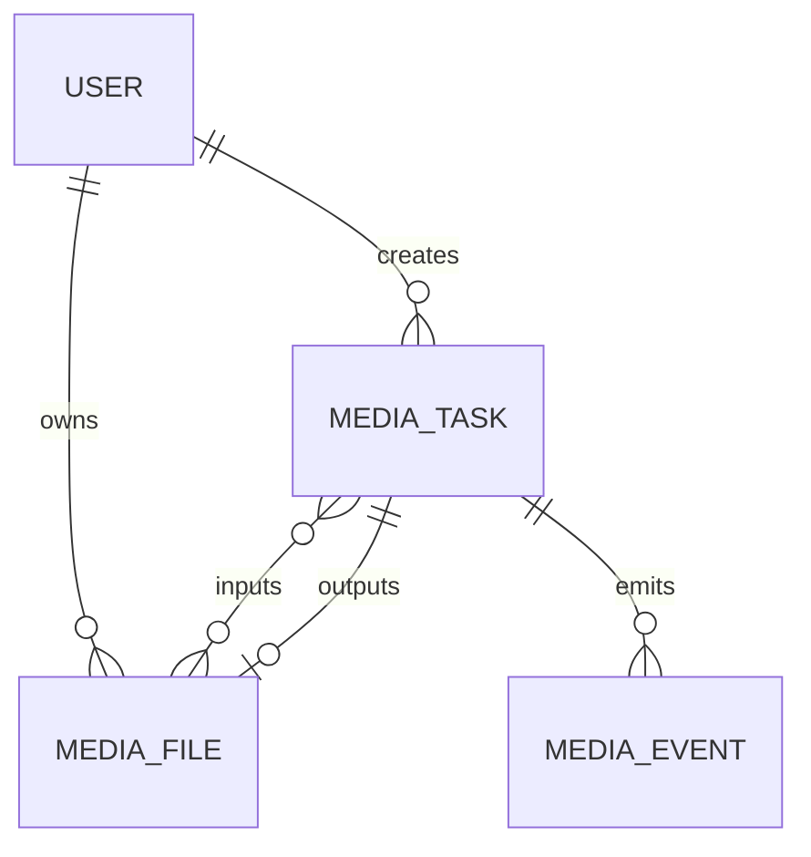

# 视频工具箱数据模型

## 1. MediaFile

| 字段 | 类型 | 可空 | 约束 | 说明 |
|---|---|---:|---|---|
| id | UUID | 否 | PK | 文件记录 ID |
| user_id | UUID | 否 | FK users.id, index | 所属用户 |
| storage_key | string | 否 | index | 对象存储键，不返回真实路径 |
| original_name | string | 否 | 长度限制 | 原始文件名 |
| media_type | enum | 否 | video/audio/image | 媒体类型 |
| source_format | string | 否 | 白名单 | 输入格式 |
| size_bytes | bigint | 否 | >0 | 文件大小 |
| duration_ms | bigint | 是 | >=0 | 媒体时长 |
| metadata_json | jsonb | 是 | 脱敏 | 探测结果 |
| created_at | timestamptz | 否 | default now | 创建时间 |
| expires_at | timestamptz | 否 | index | 清理时间 |

## 2. MediaTask

| 字段 | 类型 | 可空 | 约束 | 说明 |
|---|---|---:|---|---|
| id | UUID | 否 | PK | 任务 ID |
| user_id | UUID | 否 | FK, index | 所属用户 |
| tool_name | string | 否 | whitelist | 工具名称 |
| status | enum | 否 | 状态机 | pending/processing/completed/failed/cancelled |
| input_file_ids | jsonb | 否 | 非空数组 | 输入文件 ID |
| options_json | jsonb | 否 | 经过校验 | 规范化参数 |
| output_file_id | UUID | 是 | FK MediaFile.id | 输出文件 |
| progress | smallint | 否 | 0..100 | 进度 |
| error_code | string | 是 | 业务错误码 | 脱敏错误 |
| retry_count | smallint | 否 | >=0 | 重试次数 |
| celery_task_id | string | 是 | index | Worker 任务 ID |
| started_at | timestamptz | 是 |  | 开始时间 |
| finished_at | timestamptz | 是 |  | 结束时间 |
| created_at | timestamptz | 否 | default now | 创建时间 |

## 3. MediaEvent

记录任务创建、开始、进度、完成、失败、下载和清理事件。字段包括 `id`、`task_id`、`user_id`、`event_name`、`payload_json`、`created_at`。

## 4. 关键不变量

- `MediaTask.user_id` 必须与所有输入文件的 `user_id` 一致。
- `completed` 任务必须有 `output_file_id` 和有效过期时间。
- 客户端传入的 FFmpeg 参数必须先转换成服务端白名单结构。
- 原文件和结果文件不得使用用户可控路径拼接。
- 删除用户时，任务元数据按保留策略处理，对象存储文件异步删除。

## 5. Mermaid ER

## 6. 迁移建议

建议迁移文件：`add_media_toolbox_tables.py`。优先使用 PostgreSQL enum 或受约束字符串，避免将 FFmpeg 内部字段直接暴露为公共数据库契约。
