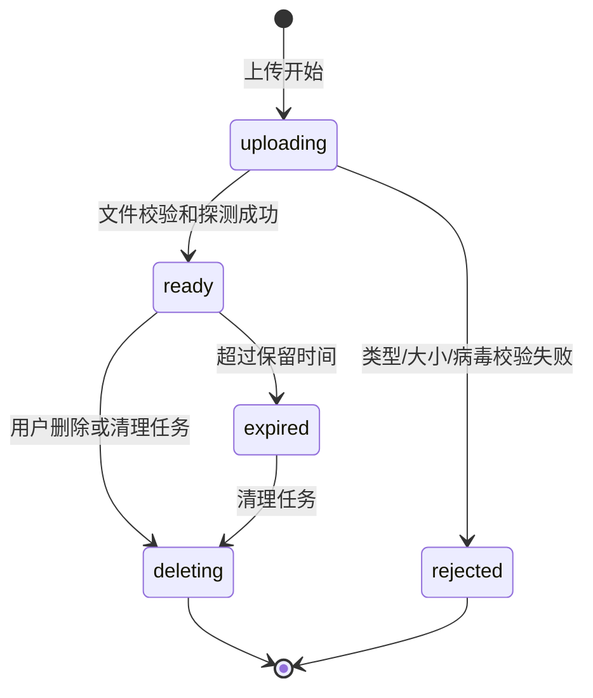
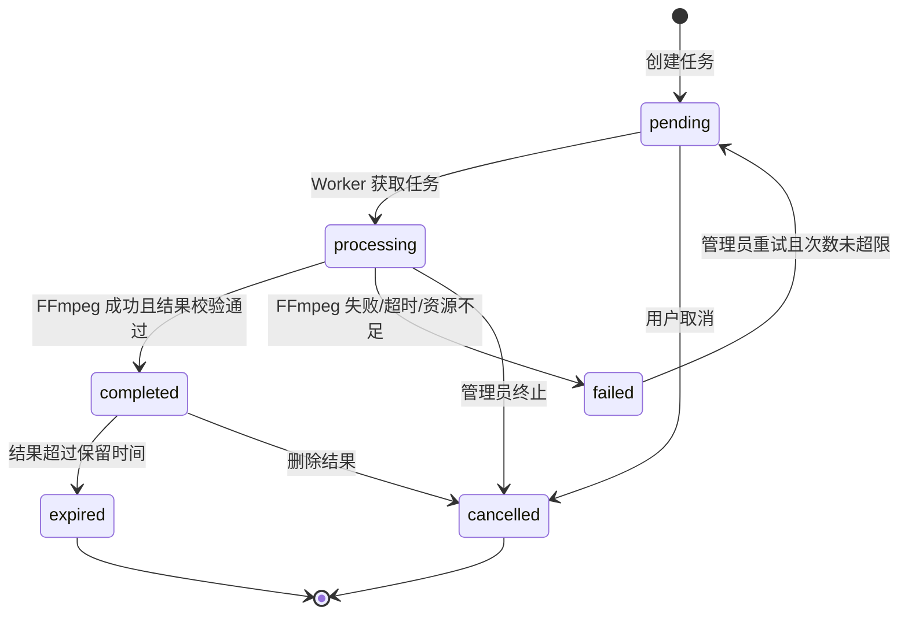

# 视频工具箱状态机

## 1. MediaFile

## 2. MediaTask

## 3. 转换约束

- `pending -> processing` 必须创建 trace/span 和 Worker 记录。
- `processing -> completed` 必须完成输出文件存在性、大小、媒体类型和可读性校验。
- `processing -> failed` 只保存业务错误码，原始 stderr 进入受控日志并脱敏。
- 任务超时、Worker 重启时由 Celery 重试或标记失败，不允许长期停留在 `processing`。
