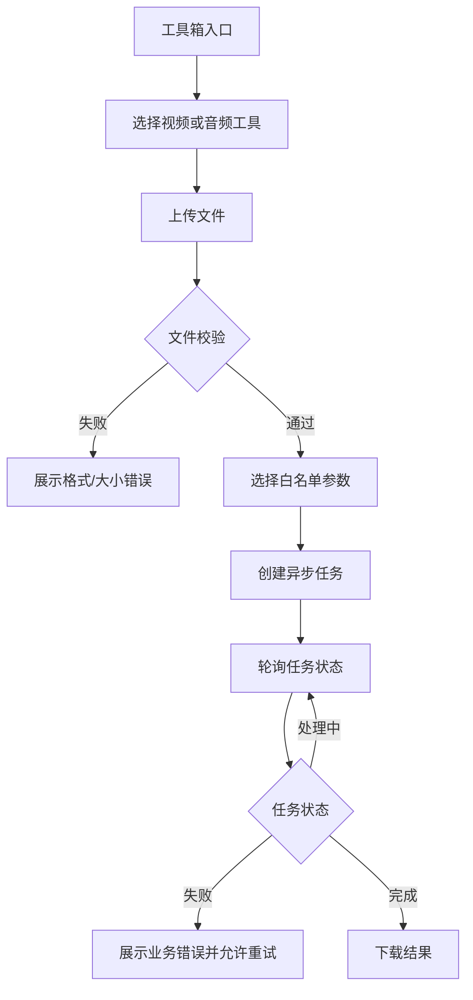

# 视频工具箱用户流程与页面规划

## 1. 页面清单

- 工具箱入口：展示工具卡片、支持格式、限制和最近任务。
- 工具处理页：上传区、参数区、任务列表、进度和结果操作。
- 任务详情页：输入文件、参数摘要、状态、失败原因和下载按钮。
- 管理后台任务页：任务筛选、失败原因、重试和终止。

## 2. P0 流程

## 3. 交互要求

- 移动端优先，上传按钮和下载按钮满足可访问点击区域。
- 必须有 loading、empty、error、success 四种状态。
- 任务处理中允许离开页面，重新进入后可从“我的任务”恢复。
- 不展示服务器绝对路径和原始 FFmpeg 命令。
- 大文件上传显示分片或整体上传进度；第一版可使用整体上传进度。
- 页面设计沿用当前主站的导航、主题、认证和通知体系，不复制 `项目1` 的 Electron 页面。

## 4. 前端模块建议

- `src/api/mediaTool.js`：上传、创建任务、查询任务、下载。
- `src/views/MediaTools.vue`：工具箱入口。
- `src/views/MediaToolTask.vue`：通用任务页。
- `src/components/media/MediaUploader.vue`、`MediaTaskCard.vue`、`MediaOptionsForm.vue`。
