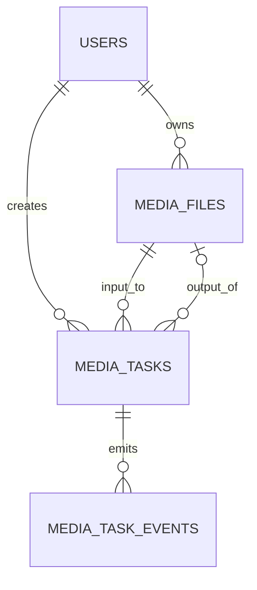

# 媒体工具数据模型

## 1. 设计原则

媒体任务记录必须使用当前用户 ID 做所有权边界。物理路径不暴露给前端，前端只使用 `file_id`、`task_id` 和受控下载地址。源文件、临时文件和结果文件分开记录，结果清理不能删除仍被其他任务引用的源文件。

## 2. Entity: media_files

| 字段 | 类型 | 可空 | 默认 | 唯一 | 索引 | 外键 | 说明 |
|---|---|---:|---|---:|---:|---|---|
| id | UUID | 否 | generated | 是 | PK | - | 文件 ID |
| user_id | BIGINT | 否 | - | 否 | idx | users.id | 文件拥有者 |
| storage_key | VARCHAR(1024) | 否 | - | 是 | unique | - | 原文件对象 key |
| original_name | VARCHAR(255) | 否 | - | 否 | idx | - | 用户文件名 |
| media_kind | VARCHAR(16) | 否 | - | 否 | idx | - | video/audio/image/future |
| extension | VARCHAR(16) | 否 | - | 否 | - | - | 原始扩展名 |
| mime_type | VARCHAR(128) | 否 | - | 否 | - | - | MIME |
| size_bytes | BIGINT | 否 | - | 否 | - | - | 文件大小 |
| duration_seconds | NUMERIC(12,3) | 是 | null | 否 | - | - | 媒体时长 |
| width | INTEGER | 是 | null | 否 | - | - | 视频宽度 |
| height | INTEGER | 是 | null | - | - | - | 视频高度 |
| has_video | BOOLEAN | 否 | false | 否 | - | - | 是否有视频流 |
| has_audio | BOOLEAN | 否 | false | 否 | - | - | 是否有音频流 |
| probe_json | JSONB | 是 | null | 否 | - | - | 受控元数据快照 |
| status | VARCHAR(16) | 否 | active | 否 | idx | - | active/deleted/blocked |
| expires_at | TIMESTAMPTZ | 是 | null | 否 | idx | - | 原文件过期时间 |
| created_at | TIMESTAMPTZ | 否 | now | 否 | idx | - | 创建时间 |
| updated_at | TIMESTAMPTZ | 否 | now | 否 | - | - | 更新时间 |

## 3. Entity: media_tasks

| 字段 | 类型 | 可空 | 默认 | 唯一 | 索引 | 外键 | 说明 |
|---|---|---:|---|---:|---:|---|---|
| id | UUID | 否 | generated | 是 | PK | - | 任务 ID |
| user_id | BIGINT | 否 | - | 否 | idx | users.id | 任务拥有者 |
| tool_code | VARCHAR(48) | 否 | - | 否 | idx | - | convert/compress/merge/gif/watermark |
| status | VARCHAR(16) | 否 | queued | 否 | idx | - | queued/processing/completed/failed/cancelled |
| stage | VARCHAR(32) | 是 | queued | 否 | - | - | upload/probe/encode/store |
| progress | SMALLINT | 否 | 0 | 否 | - | - | 0-100 |
| input_file_ids | JSONB | 否 | [] | 否 | - | media_files.id | 输入文件 ID 数组 |
| output_file_id | UUID | 是 | null | 否 | idx | media_files.id | 输出文件 |
| options_json | JSONB | 否 | {} | 否 | - | - | 已校验任务参数 |
| celery_task_id | VARCHAR(255) | 是 | null | 是 | unique | - | Celery 任务 ID |
| error_code | VARCHAR(64) | 是 | null | 否 | idx | - | 稳定错误码 |
| error_message | TEXT | 是 | null | 否 | - | - | 用户可读错误 |
| retry_count | SMALLINT | 否 | 0 | 否 | - | - | 重试次数 |
| started_at | TIMESTAMPTZ | 是 | null | 否 | - | - | 开始时间 |
| completed_at | TIMESTAMPTZ | 是 | null | 否 | - | - | 完成时间 |
| expires_at | TIMESTAMPTZ | 是 | null | 否 | idx | - | 结果过期时间 |
| created_at | TIMESTAMPTZ | 否 | now | 否 | idx | - | 创建时间 |
| updated_at | TIMESTAMPTZ | 否 | now | 否 | - | - | 更新时间 |

## 4. Entity: media_task_events

| 字段 | 类型 | 可空 | 默认 | 唯一 | 索引 | 外键 | 说明 |
|---|---|---:|---|---:|---:|---|---|
| id | BIGSERIAL | 否 | sequence | 是 | PK | - | 事件 ID |
| task_id | UUID | 否 | - | 否 | idx | media_tasks.id | 任务 |
| status | VARCHAR(16) | 否 | - | 否 | idx | - | 状态快照 |
| stage | VARCHAR(32) | 否 | - | 否 | - | - | 阶段 |
| progress | SMALLINT | 否 | 0 | 否 | - | - | 进度 |
| message | VARCHAR(255) | 是 | null | 否 | - | - | 事件消息 |
| created_at | TIMESTAMPTZ | 否 | now | 否 | idx | - | 时间 |

## 5. 不变量

- `progress` 必须在 0 到 100 之间。
- `completed` 必须有 `output_file_id`，除非工具定义为无文件输出。
- `failed` 必须有 `error_code` 和 `error_message`。
- `cancelled` 不得继续写入新的输出文件。
- 所有查询必须同时限制 `user_id`，管理员聚合查询除外。
- `input_file_ids` 中的文件必须属于任务用户，且状态为 active。
- 结果文件过期后不可下载，但保留统计记录。
- 同一用户相同输入文件和相同参数存在 queued/processing 任务时，默认拒绝重复创建。

## 6. Mermaid ER

## 7. 迁移文件

建议文件名：`ai-interview-backend/migrations/versions/<revision>_add_media_tools_tables.py`。

迁移必须包含三张表、用户索引、任务状态索引、过期清理索引和必要的 JSONB 字段。不得把物理文件复制到迁移目录。
