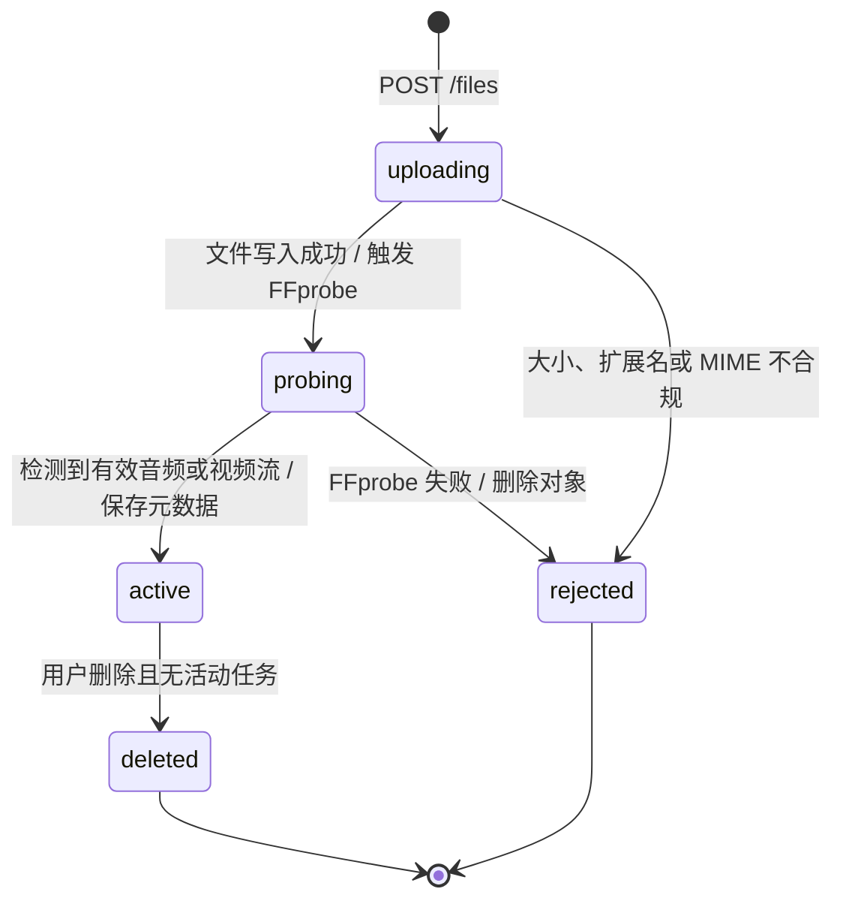
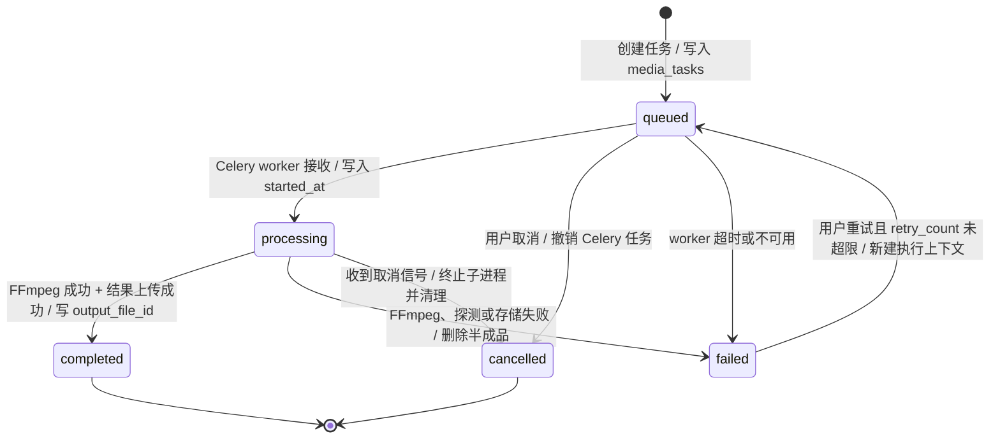

# 媒体工具状态机

## 1. MediaFile 状态

约束：`rejected` 必须删除临时对象；`active` 文件被任务引用时不能物理删除。

## 2. MediaTask 状态

## 3. 阶段定义

- `upload`：接收文件。
- `probe`：读取媒体流和元数据。
- `queued`：等待 worker。
- `preparing`：校验输入和构建 FFmpeg 参数。
- `encoding`：FFmpeg 正在处理。
- `storing`：上传结果并写入数据库。
- `cleanup`：清理临时文件。

## 4. 转换规则

每次状态变化必须追加 `media_task_events`，并更新 Redis 进度。任务只有在输出对象上传成功、数据库事务提交成功后才能进入 `completed`。任何中途异常都必须先清理输出，再进入 `failed`；清理失败写日志和告警，但不得把失败任务伪装成成功。
