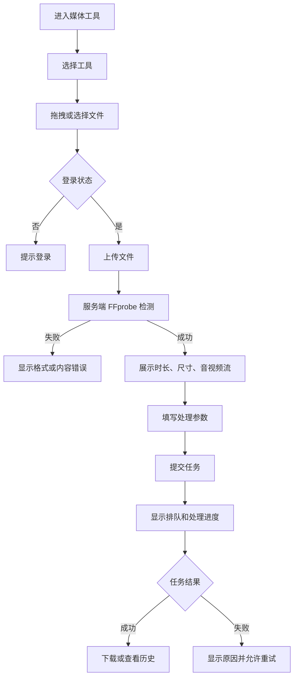
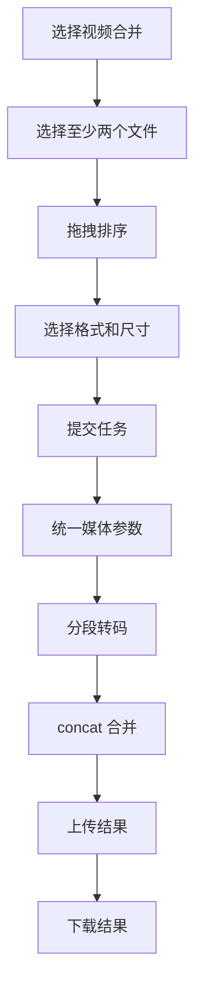

# 媒体工具用户流程与页面说明

## 1. 信息架构

综合工具平台新增一级分类“视频与音频工具”，页面不复制项目1前端，而是复用当前主站的导航、主题、登录、通知和文件上传基础组件。

页面清单：

- 媒体工具首页：工具卡片、格式能力、最近任务入口。
- 视频格式转换：单文件上传、目标格式、基础/高级参数、任务进度。
- 视频压缩：质量档位、分辨率、预计体积提示。
- 音频转换：输入媒体、目标音频格式、采样率、声道、码率。
- 视频合并：多文件排序、统一输出配置、合并进度。
- 视频转 GIF：时间范围、宽度、FPS、质量和速度。
- 视频水印：文字/图片、位置、透明度、时间范围。
- 视频隐私处理：矩形区域、模糊或颜色遮挡。
- 我的媒体任务：筛选、状态、下载、重试、删除。

## 2. 上传到转换流程

## 3. 合并流程

## 4. 四态要求

每个工具页面必须实现：

- 加载态：上传、探测、任务状态轮询和历史加载使用 skeleton 或明确 loading。
- 空态：没有文件或没有历史时给出下一步操作。
- 错误态：展示用户可理解的错误码映射、重试和返回编辑入口。
- 成功态：展示结果格式、大小、处理耗时、下载和再次处理入口。

## 5. 交互与响应式

- 375px：单列布局，参数面板可折叠，底部固定主要操作。
- 768px：文件列表和参数区分栏。
- 1024px 以上：预览/参数/任务信息可三段布局。
- 大文件上传显示已上传字节数和可取消操作。
- 任务轮询间隔 1 秒起步，进入长处理阶段后退避到 2-5 秒；页面恢复焦点时立即刷新。
- 不使用源项目页面、Element Plus 视觉结构或源项目会员弹窗。
